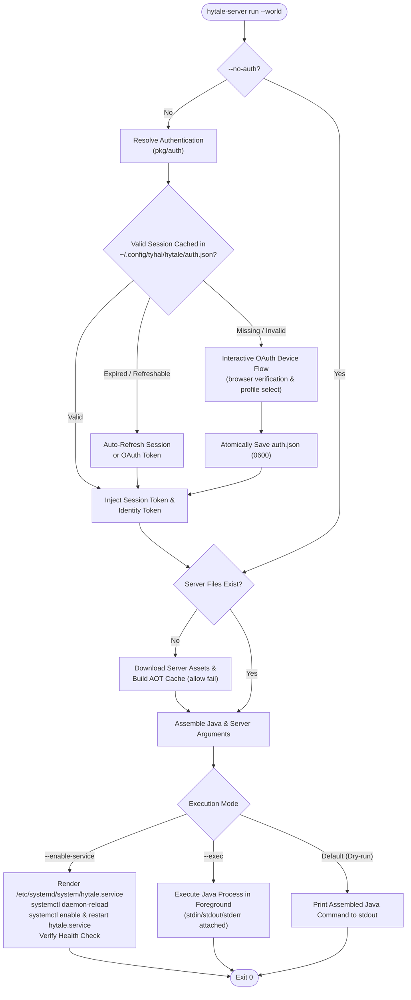

<h1 align="center">
    hytale.
</h1>

    Go packages and CLI utilities to manage, update, authenticate, and run Hytale Dedicated Servers

### Commands

#### `hytale-server update`
Downloads the official Hytale downloader, fetches game server assets (`server.zip`), extracts them, and generates an Ahead-of-Time (AOT) compilation cache.

| Flag | Type | Description |
| :--- | :--- | :--- |
| `--allow-aot-fail` | bool | Allows AOT cache generation to fail gracefully without stopping updates. |
| `--credentials-path` | string | Custom path to credentials JSON file for the downloader (defaults to `~/.config/tyhal/hytale/downloader.json`). |

#### `hytale-server run`
Launches the Hytale Dedicated Server, resolving authentication tokens, configuring JVM options, and managing foreground or systemd daemon lifecycles. Automatically downloads game server files if missing.

| Flag | Type | Description |
| :--- | :--- | :--- |
| `--world` | string (required) | Path to the world directory where the server will run. |
| `--no-auth` | bool | Skips automatic authentication and token injection. |
| `--reauth` | bool | Forces interactive browser device-code authentication flow. |
| `--ipv6` | bool | Configures JVM socket options for IPv6 networking (`-Djava.net.preferIPv6Addresses=true`). |
| `--backup-path` | string | Enables automated world backups to the specified directory. |
| `--exec` | bool | Runs the server directly in the foreground. |
| `--enable-service` | bool | Provisions `/etc/systemd/system/hytale.service`, starts it, and verifies unit health. |

#### `hytale-auth`
Standalone CLI utility to inspect current authentication tokens, verify session expiration, or manually perform the interactive OAuth login flow.

| Flag | Type | Description |
| :--- | :--- | :--- |
| `--reauth`, `--force` | bool | Forces interactive browser device-code authentication flow and updates cache. |